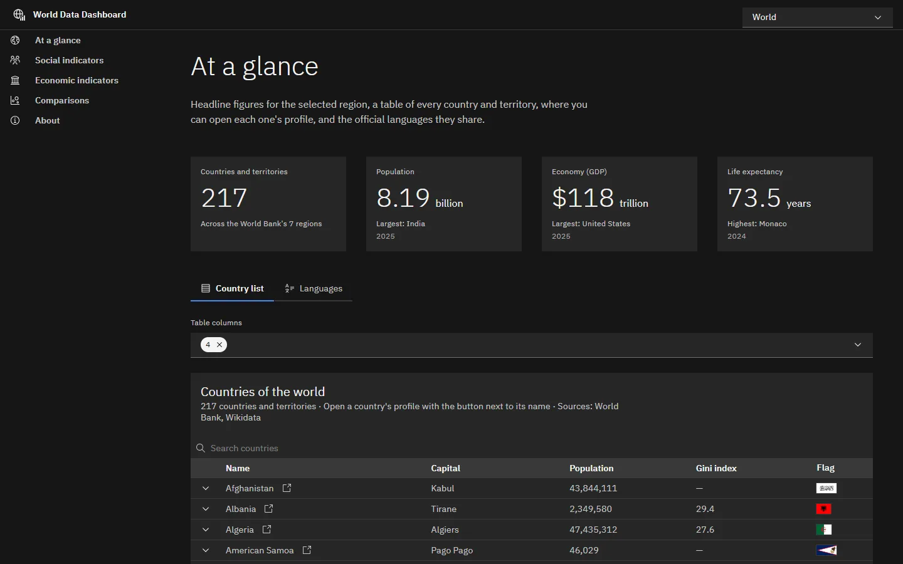

# carbonite

<!-- badges: start -->
[](https://github.com/etbrand/carbonite/actions/workflows/R-CMD-check.yaml)
<!-- badges: end -->

IBM's [Carbon Design System](https://www.carbondesignsystem.com/) for
[Shiny](https://shiny.posit.co/) apps. carbonite wraps Carbon's official web
components (`@carbon/web-components`) as inputs, outputs and layouts, without
managing JavaScript dependencies or CDN assets.

[](https://evan-brand-worlddata.share.connect.posit.cloud/)

*[World Data Dashboard](https://evan-brand-worlddata.share.connect.posit.cloud/),
built with carbonite ([source](https://github.com/etbrand/worlddata)).*

## Packages

| Package | Directory | Status |
|---|---|---|
| carbonite for R Shiny | [`r-shiny/`](r-shiny/) | Available: see the [R package's README](r-shiny/README.md) |
| carbonite for Dash | `py-dash/` | Planned |
| carbonite for Shiny for Python | `py-shiny/` | Planned |

Install the R package with:

```r
# install.packages("pak")
pak::pak("etbrand/carbonite/r-shiny")
```

## Repository layout

- `r-shiny/` — the R package.
- `srcjs/` — the JavaScript and Sass shared by the packages: Carbon's
  components and styles, fixes to them, and the Shiny input bindings.
  `cd srcjs && npm install && npm run build` rebuilds the R package's
  `r-shiny/inst/www/carbon/` bundle.

## License

carbonite is released under the MIT license. It bundles Carbon's web
components, styles and icons (Apache-2.0, IBM), IBM Plex fonts (SIL Open
Font License 1.1, IBM), and other open-source libraries; see
[`r-shiny/inst/COPYRIGHTS`](r-shiny/inst/COPYRIGHTS) for their copyright
holders and licenses.

IBM, Carbon, and IBM Plex are trademarks of IBM Corp. carbonite is not
affiliated with or endorsed by IBM.
