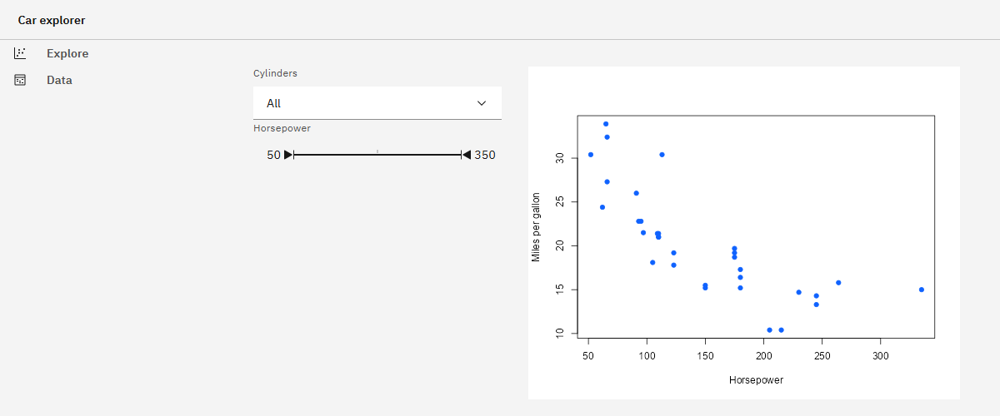
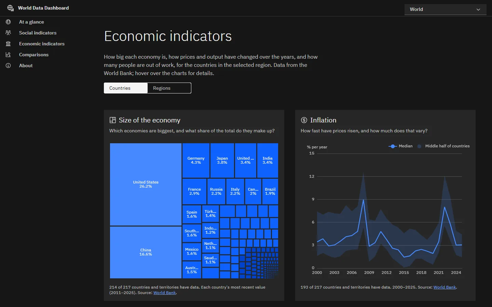

# carbonite

[Shiny](https://shiny.posit.co/) bindings for IBM's
[Carbon Design System](https://www.carbondesignsystem.com/).

`carbonite` wraps Carbon's official web components (`@carbon/web-components`)
as Shiny inputs, outputs and layouts. Use Carbon for Shiny apps, without managing JavaScript dependencies or CDN assets.

[](https://evan-brand-worlddata.share.connect.posit.cloud/)

*[World Data Dashboard](https://evan-brand-worlddata.share.connect.posit.cloud/),
built with carbonite. Data from the World Bank and Wikidata.*

## Installation

Install the development version from GitHub:

```r
# install.packages("pak")
pak::pak("etbrand/carbonite")
```

## Example

A two-page app, with a side navigation, inputs, a plot and a data table:

```r
library(shiny)
library(carbonite)

cars <- data.frame(model = rownames(mtcars), mtcars[, c("mpg", "cyl", "hp")])

ui <- carbon_page(
  title = "Car explorer",
  theme = "g10",
  sidebar = carbon_sidebar(
    carbon_nav_item("explore", "Explore", icon = "chart--scatter"),
    carbon_nav_item("data", "Data", icon = "data-table")
  ),
  carbon_panel(
    "explore",
    carbon_grid(
      carbon_column(
        width = 6,
        carbon_select("cyl", "Cylinders", c(All = "all", "4", "6", "8"), selected = "all"),
        carbon_slider("hp", "Horsepower", min = 50, max = 350, value = c(50, 350), step = 10,
          hide_text_input = TRUE)
      ),
      carbon_column(width = 10, plotOutput("plot"))
    )
  ),
  carbon_panel(
    "data",
    carbon_table_output("table")
  )
)

server <- function(input, output, session) {
  filtered <- reactive({
    rows <- cars$hp >= input$hp[1] & cars$hp <= input$hp[2]
    if (input$cyl != "all") rows <- rows & cars$cyl == as.numeric(input$cyl)
    cars[rows, ]
  })

  output$plot <- renderPlot({
    plot(mpg ~ hp, data = filtered(), pch = 19, col = "#0f62fe",
      xlab = "Horsepower", ylab = "Miles per gallon")
  })

  output$table <- render_carbon_table({
    carbon_table(filtered(), sortable = TRUE, page_size = 10,
      toolbar = carbon_table_toolbar())
  })
}

shinyApp(ui, server)
```



carbonite's inputs work like Shiny's: read them with `input$<id>`, react to
them with `observeEvent()`, and change them from the server with the
matching `update_carbon_*()` function. They also work in Shiny modules, and
outside `carbon_page()` in any Shiny UI.

## Demo app

[World Data Dashboard](https://evan-brand-worlddata.share.connect.posit.cloud/)
is a larger carbonite app in Carbon's dark `"g100"` theme: country
profiles, charts of social and economic indicators, and comparisons, using data from the World Bank and Wikidata (view source code at
[etbrand/worlddata](https://github.com/etbrand/worlddata)).

[](https://evan-brand-worlddata.share.connect.posit.cloud/)

## Components

| Area | Functions |
|---|---|
| Page and layout | `carbon_page()`, `carbon_sidebar()`, `carbon_nav_item()`, `carbon_panel()`, `carbon_grid()`, `carbon_column()`, `carbon_tabs()`, `carbon_accordion()`, `carbon_tile()`, `carbon_expandable_tile()`, `carbon_content_switcher()` |
| Text inputs | `carbon_text_input()`, `carbon_password_input()`, `carbon_textarea()`, `carbon_number_input()` |
| Choices | `carbon_select()`, `carbon_dropdown()`, `carbon_combobox()`, `carbon_multiselect()`, `carbon_radio_group()`, `carbon_checkbox_group()`, `carbon_toggle()`, `carbon_structured_list()` |
| Ranges, dates and files | `carbon_slider()`, `carbon_date_picker()`, `carbon_date_range_picker()`, `carbon_time_picker()`, `carbon_file_uploader()` |
| Actions | `carbon_button()`, `carbon_menu_button()`, `carbon_overflow_menu()`, `carbon_selectable_tag()`, `carbon_dismissible_tag()`, `carbon_operational_tag()` |
| Data tables | `carbon_table()`, `carbon_table_output()`, `render_carbon_table()`, with sorting, search, row selection, batch actions, pagination and expandable rows |
| Feedback | `show_carbon_modal()`, `show_carbon_notification()`, `carbon_inline_notification()`, `carbon_progress_bar()`, `carbon_progress_indicator()`, `carbon_popover()`, `carbon_tag()` |
| Icons | `carbon_icon()`, `carbon_icon_names()`: all of Carbon's icons as inline SVG |

## Themes

`carbon_page(theme = )` sets one of Carbon's four themes: `"white"`, `"g10"`
(light), or `"g90"` and `"g100"` (dark). Viewers whose browser or operating
system is set to dark mode get the `"g100"` theme.

## Development

The R code is in `R/`. The JavaScript and Sass that build the bundled
`inst/www/carbon/` files are in `srcjs/`:

```sh
cd srcjs
npm install
npm test        # JavaScript tests
npm run build   # rebuilds inst/www/carbon/
```

Run the R tests with `devtools::test()`. `data-raw/` has small demo apps for
the components.

## License

carbonite is released under the MIT license. It bundles Carbon's web
components, styles and icons (Apache-2.0, IBM), IBM Plex fonts (SIL Open
Font License 1.1, IBM), and other open-source libraries; see
[`inst/COPYRIGHTS`](inst/COPYRIGHTS) for their copyright holders and licenses.

IBM, Carbon, and IBM Plex are trademarks of IBM Corp. carbonite is not
affiliated with or endorsed by IBM.
